<h1 align="center">Vernier Throttle</h1>

<p align="center">
  <b>An open-source, 3D-printed push-pull vernier throttle for flight simulators, designed for ultralight and light aircraft.</b><br>
  Push or pull for coarse power · twist the knob for fine tuning · USB game controller · Arduino Micro + AS5600
</p>

<p align="center">
  
  
  
  
  
</p>

<p align="center">
  
  &nbsp;
  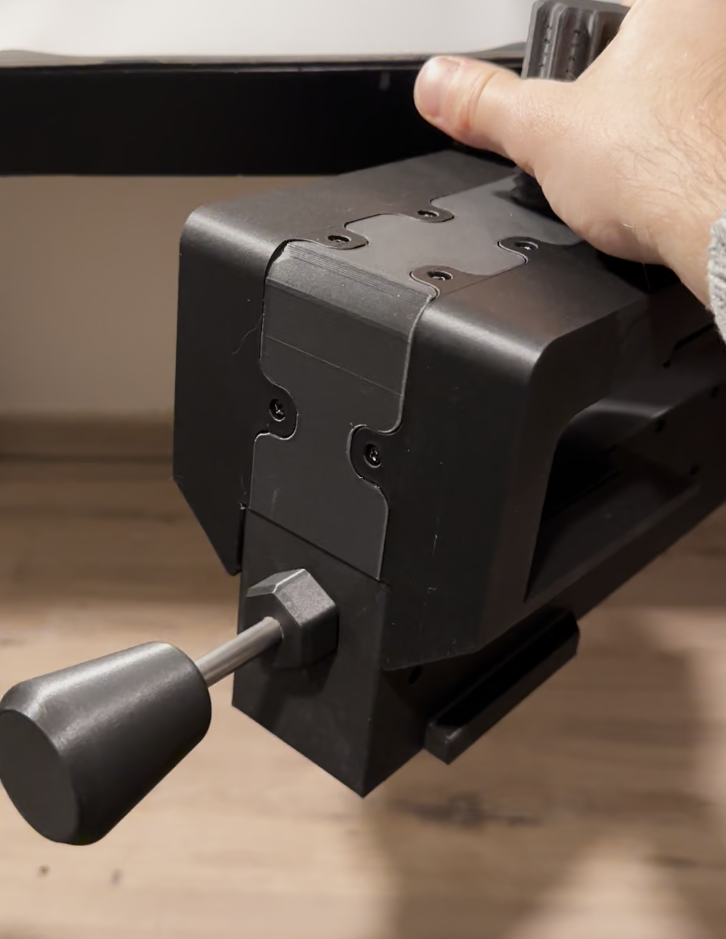
</p>

<p align="center">
  <!-- TODO: replace with the MakerWorld model URL -->
  <a href="https://makerworld.com/"></a>
  <a href="https://www.printables.com/model/1512300-vernier-throttle-for-flight-sim"></a>
  <!-- TODO: replace with the Thingiverse thing URL -->
  <a href="https://www.thingiverse.com/"></a>
</p>

<p align="center">
  <a href="#-bill-of-materials">Bill of materials</a> ·
  <a href="#-assembly-guide">Assembly guide</a> ·
  <a href="hardware/stl">STL files on GitHub</a> ·
  <a href="hardware/step">STEP files</a>
</p>

---

## Table of contents

- [Highlights](#-highlights)
- [How it works](#%EF%B8%8F-how-it-works)
- [Specifications](#-specifications)
- [Bill of materials](#-bill-of-materials)
- [Assembly guide](#-assembly-guide)
- [Electronics and firmware](#-electronics-and-firmware)
- [Using it in a simulator](#-using-it-in-a-simulator)
- [License](#-license)

## ✨ Highlights

- **Feels like the real control:** push or pull for coarse power, twist the knob for fine tuning.
- **Plug and play:** a standard USB game controller, no driver, works in any simulator.
- **Easy to build:** printed parts, an Arduino Micro, an AS5600 and a potentiometer. No custom PCB.

## ⚙️ How it works

<p align="center">
  
  <br>
  <b>Push or pull</b> the knob: the rack turns a potentiometer for the coarse throttle.
  <br>
  <b>Twist</b> it: an AS5600 reads a magnet on the rod for fine tuning, about 10 % per turn (<a href="docs/how-it-works.md">details</a>).
</p>

## 📐 Specifications

| | |
|---|---|
| Output | 1 axis (USB HID *Throttle*), 10-bit (0–1023) |
| Coarse sensor | 10 kΩ rotary potentiometer, driven by a rack and a herringbone pinion (module 1.6, 20 teeth) |
| Fine sensor | AS5600, 12-bit magnetic encoder (I²C) |
| Fine adjustment | 1 knob turn ≈ 10 % of the throttle range |
| Board | Arduino Micro (ATmega32u4, native USB) |
| Mounting | Built-in C-clamp, desks about 30 to 65 mm thick |
| Size | ≈ 300 × 116 × 230 mm (length without the knob × width of the clamp × height with the clamp screw) |

## 🧾 Bill of materials

### Printed parts (21 files, 22 pieces)

| | File | Qty | Role |
|:-:|---|:-:|---|
| 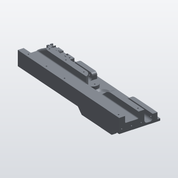 | [`Bottom_Shell_x1.stl`](hardware/stl/Bottom_Shell_x1.stl) | 1 | Lower half of the case, with the slider channel |
| 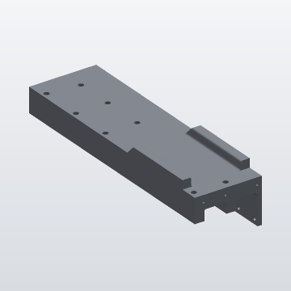 | [`Top_Shell_x1.stl`](hardware/stl/Top_Shell_x1.stl) | 1 | Upper half of the case, carries the clamp |
| 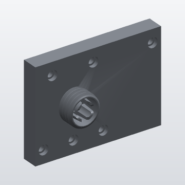 | [`Front_Plate_x1.stl`](hardware/stl/Front_Plate_x1.stl) | 1 | Front of the case, the rod goes through it |
| 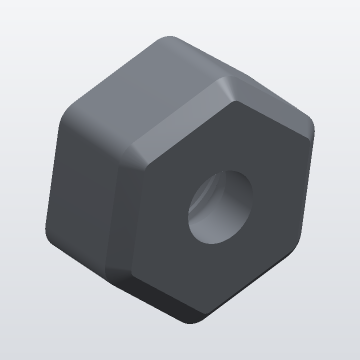 | [`Front_Nut_x1.stl`](hardware/stl/Front_Nut_x1.stl) | 1 | Hex bushing on the front plate, guides the rod |
| 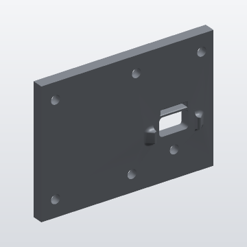 | [`Back_Plate_x1.stl`](hardware/stl/Back_Plate_x1.stl) | 1 | Back of the case, opening for the USB cable |
| 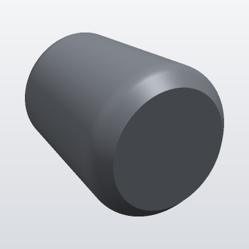 | [`Knob_x1.stl`](hardware/stl/Knob_x1.stl) | 1 | Throttle knob on the front end of the rod |
| 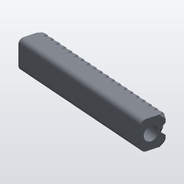 | [`Rack_Slider_x1.stl`](hardware/stl/Rack_Slider_x1.stl) | 1 | Slider with a herringbone rack, follows the push/pull motion |
| 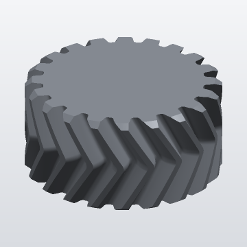 | [`Pinion_Gear_x1.stl`](hardware/stl/Pinion_Gear_x1.stl) | 1 | Herringbone pinion on the 6 mm potentiometer shaft |
| 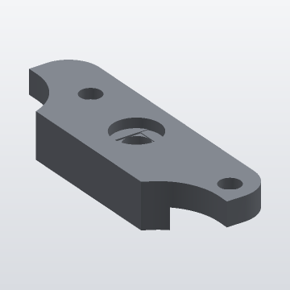 | [`Pot_Bracket_x1.stl`](hardware/stl/Pot_Bracket_x1.stl) | 1 | Holds the potentiometer under the pinion |
| 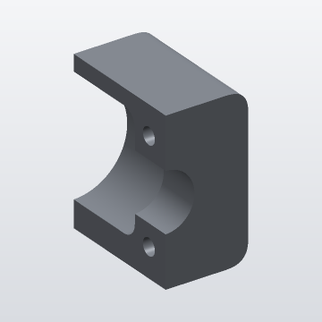 | [`AS5600_Holder_P1_x1.stl`](hardware/stl/AS5600_Holder_P1_x1.stl) | 1 | AS5600 holder, half 1. The AS5600 board screws on its back face |
| 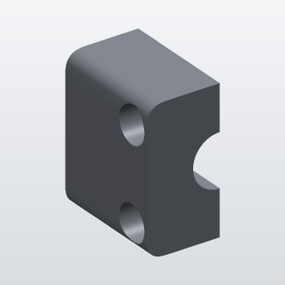 | [`AS5600_Holder_P2_x1.stl`](hardware/stl/AS5600_Holder_P2_x1.stl) | 1 | AS5600 holder, half 2 |
|  | [`Magnet_End_Cap_x1.stl`](hardware/stl/Magnet_End_Cap_x1.stl) | 1 | Cap on the rear end of the rod, inside the AS5600 holder. Its rear pocket holds the Ø 5 × 2 mm magnet |
| 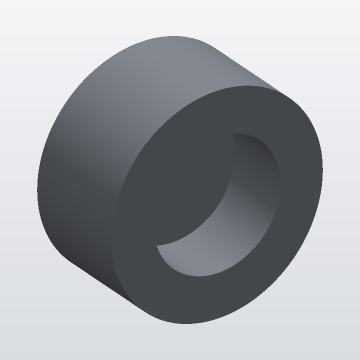 | [`Shaft_Collar_x2.stl`](hardware/stl/Shaft_Collar_x2.stl) | 2 | One at each end of the rack slider. They lock the slider on the rod along its axis |
| 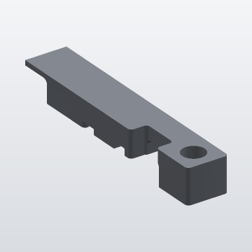 | [`Arduino_Rail_x1.stl`](hardware/stl/Arduino_Rail_x1.stl) | 1 | Holds the Arduino Micro in its pocket at the back of the case |
| 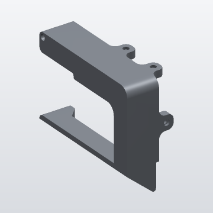 | [`Clamp_Left_x1.stl`](hardware/stl/Clamp_Left_x1.stl) | 1 | Left side of the C-clamp |
| 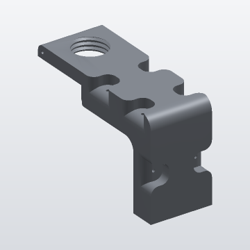 | [`Clamp_Center_x1.stl`](hardware/stl/Clamp_Center_x1.stl) | 1 | Center of the C-clamp, with the thread for the clamp screw |
| 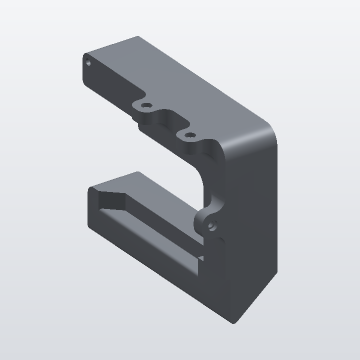 | [`Clamp_Right_x1.stl`](hardware/stl/Clamp_Right_x1.stl) | 1 | Right side of the C-clamp |
| 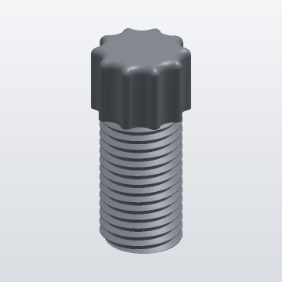 | [`Clamp_Screw_x1.stl`](hardware/stl/Clamp_Screw_x1.stl) | 1 | Thumb screw of the clamp |
| 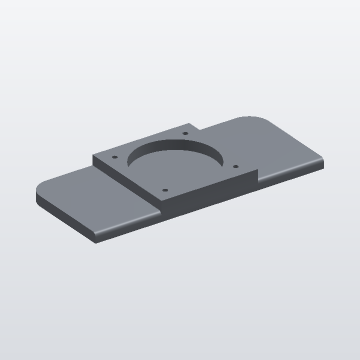 | [`Clamp_Pad_x1.stl`](hardware/stl/Clamp_Pad_x1.stl) | 1 | Pad that presses on the desk |
| 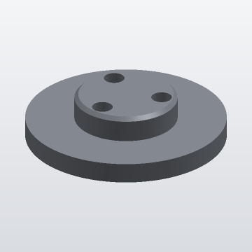 | [`Clamp_Swivel_Disc_x1.stl`](hardware/stl/Clamp_Swivel_Disc_x1.stl) | 1 | Disc on the tip of the screw, turns freely inside the pad |
| 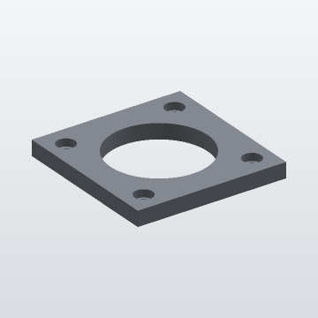 | [`Clamp_Pad_Cover_x1.stl`](hardware/stl/Clamp_Pad_Cover_x1.stl) | 1 | Closes the disc inside the pad |

### Mechanical hardware

| Item | Qty | Where |
|---|:-:|---|
| Steel rod **Ø 8 × 313 mm** | 1 | From the knob to the AS5600 holder |
| M3 self-tapping screws (for plastic), assorted lengths | 1 kit | Case, plates, clamp, AS5600 board |
| Glue (cyanoacrylate or epoxy) | — | Collars, magnet end cap, magnet and knob on the rod |

### Electronics

| Item | Qty | Notes |
|---|:-:|---|
| **Arduino Micro** (ATmega32u4) | 1 | Native USB is required. A Leonardo also works. A Pro Micro needs another analog pin, see [docs](docs/electronics-and-firmware.md#pro-micro) |
| **AS5600** magnetic encoder board, square (≈ 23 × 23 mm, 4 mounting holes) | 1 | Screws on the back of the AS5600 holder |
| Diametric magnet **Ø 5 × 2 mm** | 1 | Goes in the rear pocket of the `Magnet_End_Cap`, facing the AS5600 chip |
| Rotary potentiometer, **10 kΩ**, linear taper, 6 mm shaft, single turn | 1 | Fits the `Pot_Bracket` (anti-rotation tab in the notch) |
| Flexible stranded wire | — | The AS5600 board moves with the slider, so leave a cable loop |
| Micro-USB cable | 1 | Power and data |

## 🔧 Assembly guide

<p align="center">
  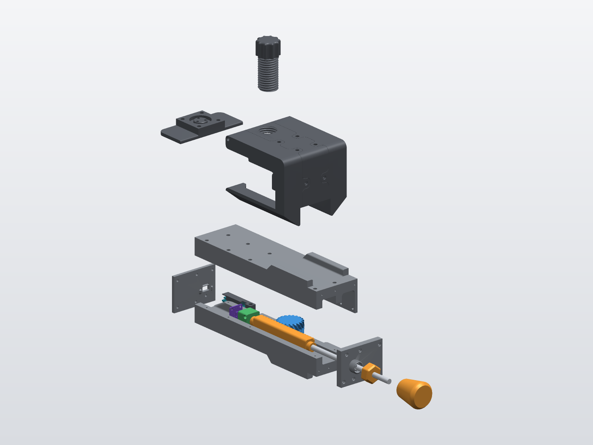
</p>

In the pictures below, **orange** marks the printed parts added at that step. The bought parts are shown in
their own colours: steel rod, potentiometer, Arduino Micro (teal), AS5600 board (purple) and the
diametric magnet (red / blue).

### Step 1: Potentiometer and pinion

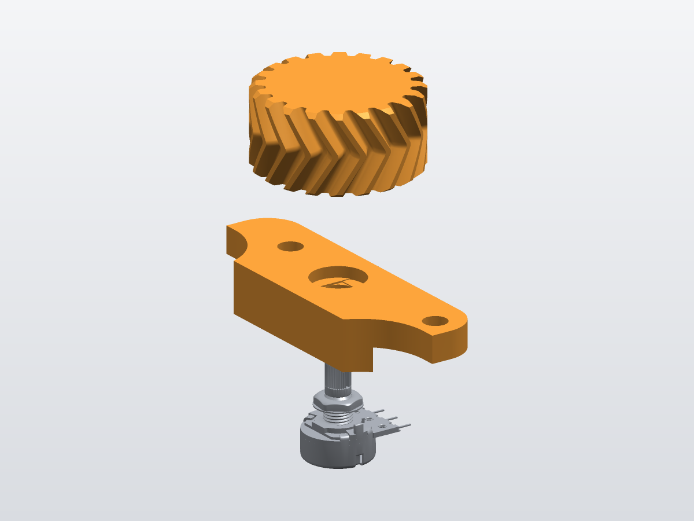 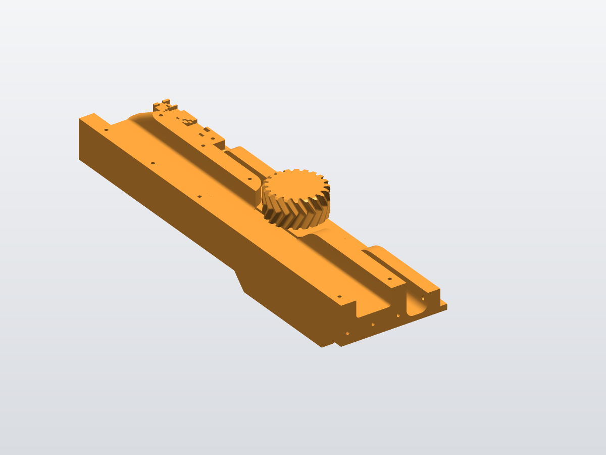

- Push the bushing of the 10 kΩ potentiometer up through the `Pot_Bracket`, with its anti-rotation tab in
  the small notch, and tighten the potentiometer nut on top.
- Press the `Pinion_Gear` onto the 6 mm potentiometer shaft.
- Screw the bracket into the `Bottom_Shell`, under the slider channel.
- Solder three wires to the potentiometer (see [Electronics and firmware](#-electronics-and-firmware)).

### Step 2: Arduino Micro

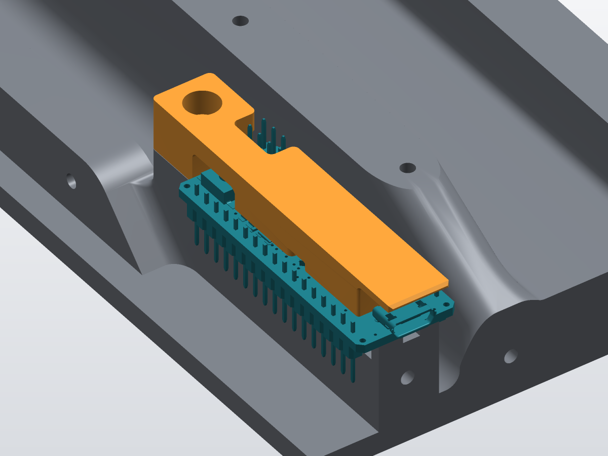 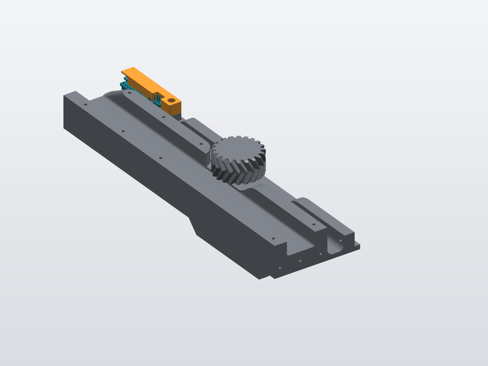

- Drop the Arduino Micro into its pocket at the back of the `Bottom_Shell`, pins down, with the USB
  connector facing the back.
- Hold it in place with the `Arduino_Rail` and its screw.

### Step 3: Rod and rack slider

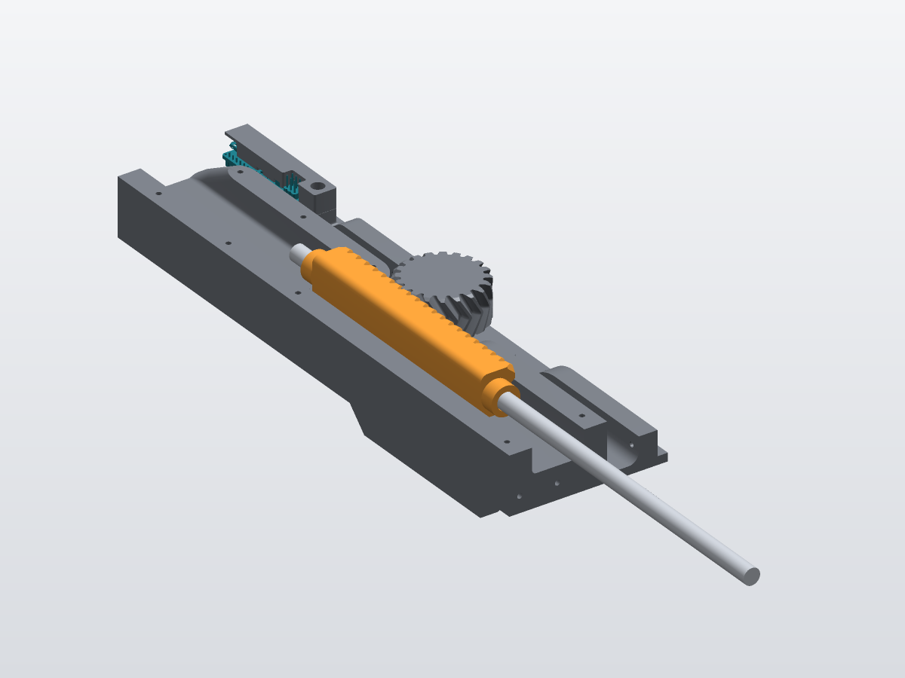

- Slide the Ø 8 × 313 mm rod through the `Rack_Slider`.
- Glue one `Shaft_Collar` against each end of the slider. The slider must follow the rod when you push or
  pull it, and the rod must still turn freely inside it.
- Lay the slider in the channel of the `Bottom_Shell`, with the rack teeth meshing with the pinion.

### Step 4: AS5600 sensor and magnet

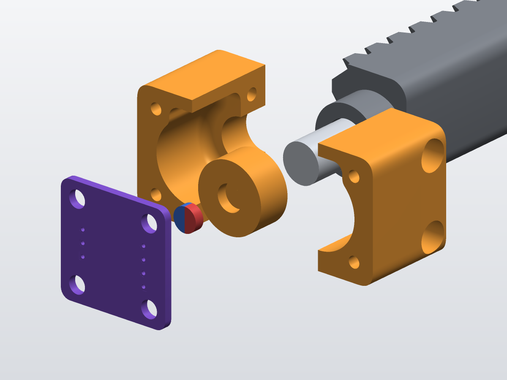 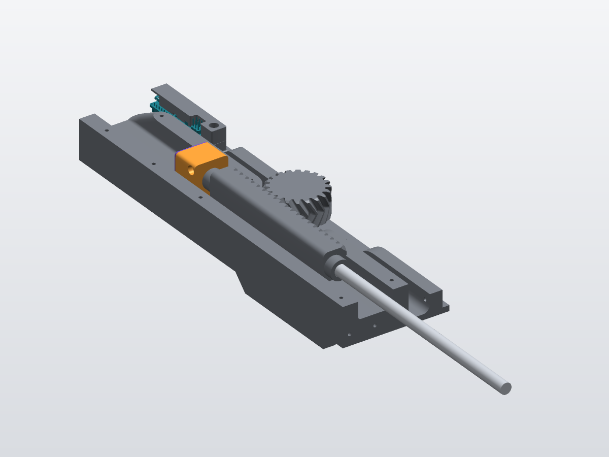

- Glue the Ø 5 × 2 mm diametric magnet in the rear pocket of the `Magnet_End_Cap`, then glue the cap on
  the rear end of the rod, magnet facing backwards.
- Close the two halves `AS5600_Holder_P1` and `AS5600_Holder_P2` around the rod, behind the rear collar.
  The cap sits in the cavity at the back of the holder.
- Screw the AS5600 board on the back face of the holder, **chip facing the magnet**. The holder now moves
  with the slider, and the magnet turns in front of the chip when you twist the knob.
- Solder flexible wires to the board and leave a loop long enough for the full travel.

### Step 5: Front and back plates

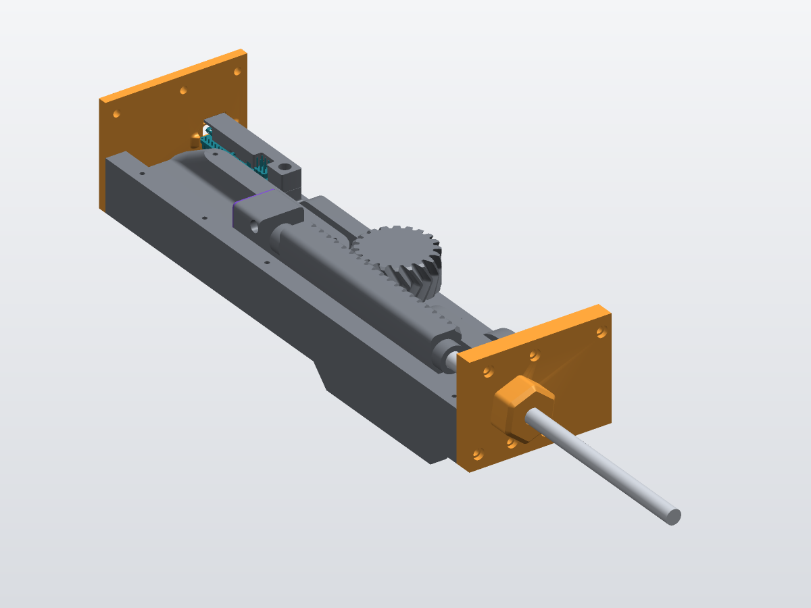

- Slide the `Front_Plate` over the rod and screw it to the front of the shell. Fit the `Front_Nut` on it.
- Pass the USB cable through the opening of the `Back_Plate` and screw the plate to the back.

### Step 6: Close the case

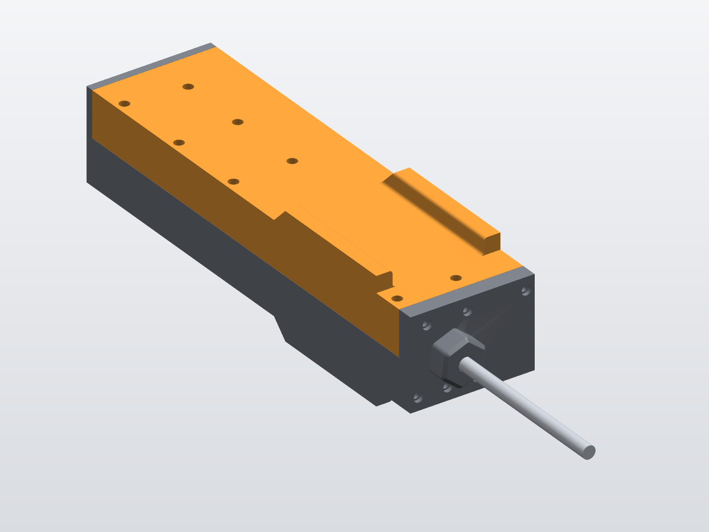

- Finish the wiring (see [Electronics and firmware](#-electronics-and-firmware)) and flash the firmware.
- Close the case with the `Top_Shell` and screw it to the `Bottom_Shell`.
- Check that the rod slides over its full travel and turns freely before you go further.

### Step 7: Clamp frame

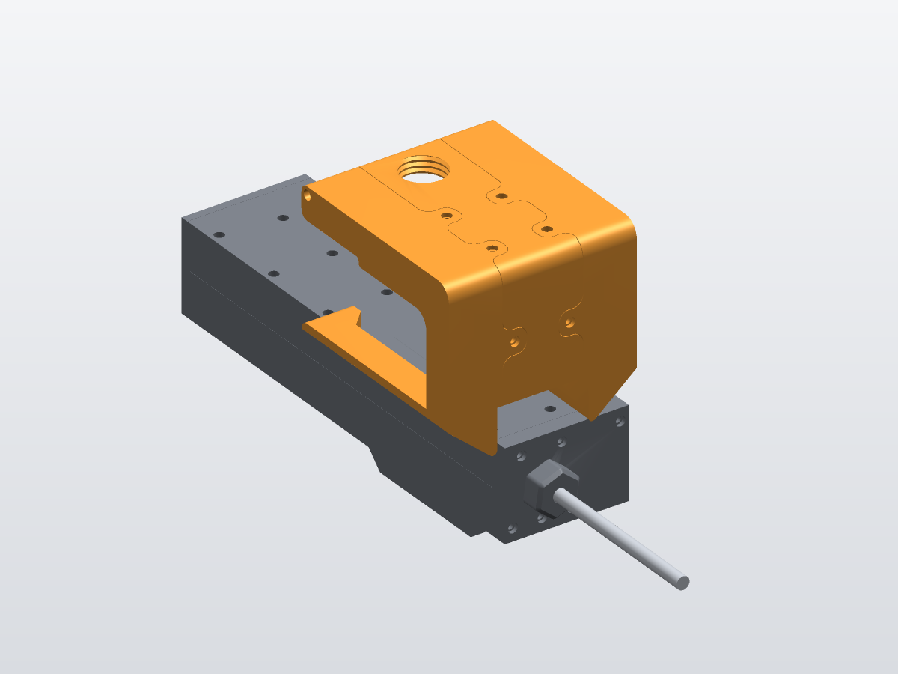

- Join `Clamp_Left`, `Clamp_Center` and `Clamp_Right` with their puzzle joints and screws.
- Screw the frame onto the front of the `Top_Shell`. The open side of the C faces the back.

### Step 8: Clamp screw

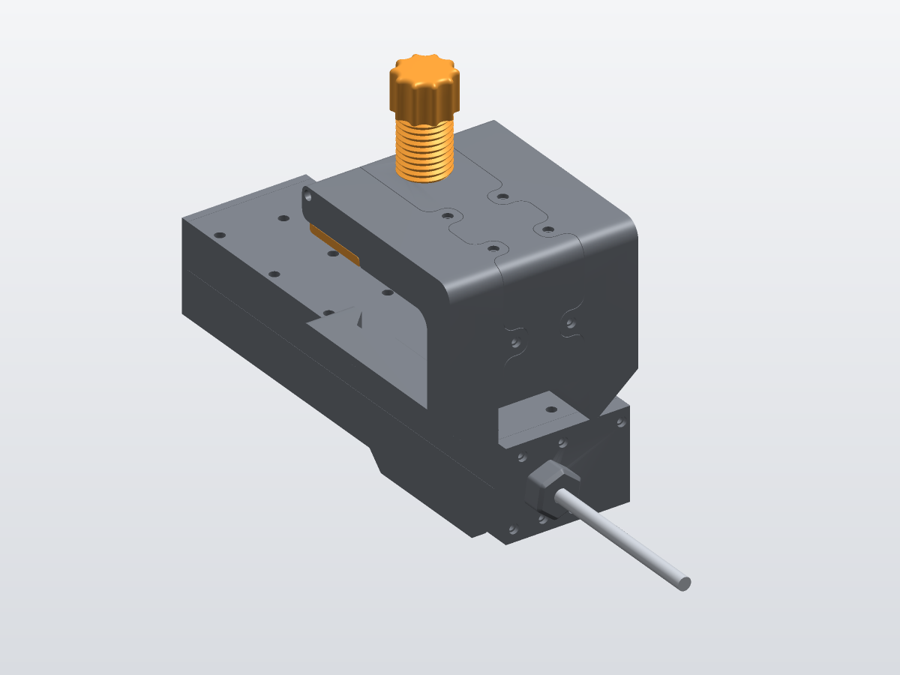

- Thread the `Clamp_Screw` into the `Clamp_Center` from the top.
- Under the arm, fix the `Clamp_Swivel_Disc` on the tip of the screw and close it inside the `Clamp_Pad`
  with the `Clamp_Pad_Cover`. The pad stays still while the screw turns, so it does not scratch the desk.

### Step 9: Knob

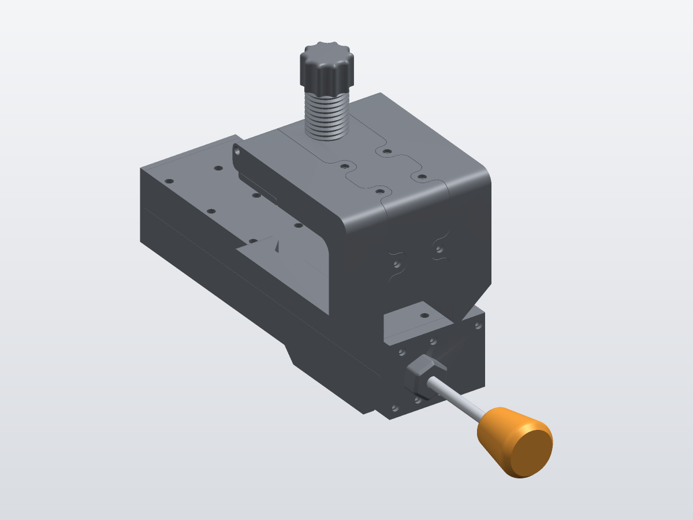

- Glue the `Knob` on the front end of the rod.

## 🔌 Electronics and firmware

<p align="center">
  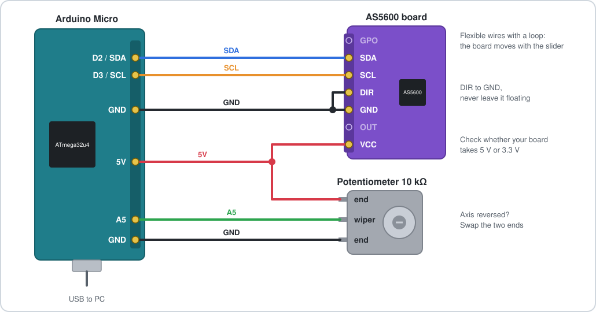
</p>

The firmware is a [PlatformIO](https://platformio.org/) project in [`firmware/`](firmware):

```bash
cd firmware
pio run -t upload
```

The board appears as a USB game controller with one throttle axis. The wiring diagram, testing on Windows
and troubleshooting are in [docs/electronics-and-firmware.md](docs/electronics-and-firmware.md).

## 🎮 Using it in a simulator

- Bind the device's **Throttle** axis to the engine throttle (for example *Throttle axis* in MSFS or
  *Throttle* in X-Plane).
- Keep the response curve **linear** and the dead zone at **0**. Otherwise the fine adjustment loses its
  feel.
- Plug the throttle in before you start the flight: the axis reads 0 % for about one second after it is
  connected.

<p align="center">
  
</p>

## 📜 License

- **Hardware** (STL, STEP, 3MF, images and documentation):
  [CC BY-NC-SA 4.0](https://creativecommons.org/licenses/by-nc-sa/4.0/). You can share and remix it
  for non-commercial use, with attribution, under the same license. See [LICENSE](LICENSE).
- **Firmware** (`firmware/`): [MIT](firmware/LICENSE).
- The bundled [Arduino Joystick Library](https://github.com/MHeironimus/ArduinoJoystickLibrary)
  (`firmware/lib/ArduinoJoystickLibrary`) by Matthew Heironimus keeps its own LGPL license.
