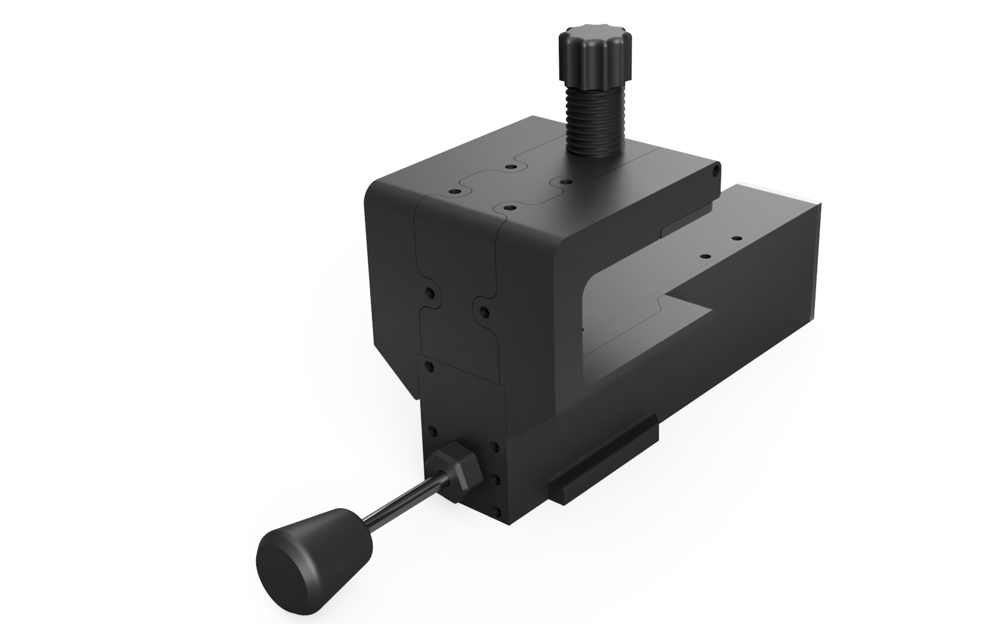

# Vernier Throttle Controller

Compact firmware that fuses an AS5600 magnetic encoder with a linear potentiometer to expose a stable USB throttle axis via the Arduino Joystick Library. Works on any ATmega32u4-style board flashed through PlatformIO.

3d files available here : https://www.printables.com/model/1512300-vernier-throttle-for-flight-sim

## Quick Facts
- Runs on Arduino Pro Micro/Leonardo class boards with native USB HID.
- Build + flash with PlatformIO: `pio run` then `pio run -t upload`.

## Hardware
| Part | Hookup |
| --- | --- |
| AS5600 encoder | I2C `SDA`/`SCL`, address `0x36`. |
| Linear potentiometer | Analog pin `A5` (editable in `src/main.cpp`). |
| MCU | ATmega32u4 board for HID; USB cable powers + carries data. |

## License
See `LICENSE` for full terms.
