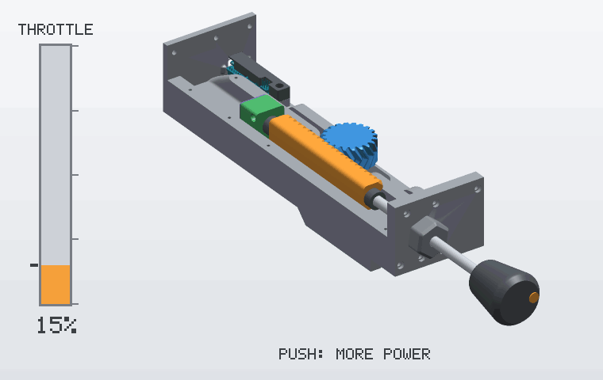
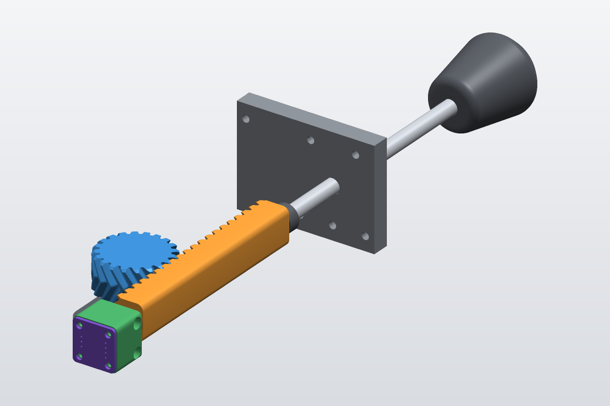

# How it works

[← Back to the README](../README.md)

<p align="center">
  
  <br>
  
</p>

## The vernier throttle

Many light aircraft and ultralights use a **push-pull** throttle instead of a lever: you push the knob
in for more power and pull it out for less. A **vernier** throttle adds fine tuning. On the real control,
the shaft is threaded: you twist the knob to screw it in or out by a few millimetres, and you press a
button in the middle of the knob to unlock the thread for large movements.

This throttle gives the same feel without a thread. The rod slides freely, and the twist is **measured**
and added to the output by the firmware.

## Mechanics

```
 Knob ─── Ø 8 mm steel rod ───────────────────────────────────────────────┐
             │ push / pull                                                │ twist
             ▼                                                            ▼
     Rack slider (moves with the rod, the rod turns freely inside it)   magnet on the rear end of the rod
             │ rack teeth                                                 │ faces
             ▼                                                            ▼
     Herringbone pinion → rotary potentiometer (fixed) → A5      AS5600 in its holder (moves with the slider) → I²C
```

- The **potentiometer is fixed** in the case. The rack converts the travel of the slider into a rotation
  of less than one turn, so a standard single-turn potentiometer covers the full travel.
- Two **shaft collars**, one at each end of the slider, lock the slider on the rod along its axis. The rod
  still turns freely inside it.
- The **AS5600 holder** sits behind the rear collar. The **magnet end cap** glued on the rear end of the rod
  sits in a cavity at the back of the holder, and the AS5600 board is screwed on the back face. The holder
  therefore moves with the slider, so the distance between the magnet and the chip stays the same over the
  whole travel. Its wires need a loop.
- The herringbone teeth (module 1.6, 20-tooth pinion) keep the pinion centred on the rack and make the
  motion smooth.

## Firmware

The firmware ([`firmware/src/main.cpp`](../firmware/src/main.cpp)) keeps one value, the throttle output
`c` from 0 to 1023, and updates it at about 1 kHz with two increments.

### Fine adjustment (AS5600)

```
Δθ        = change of the AS5600 raw angle since the last read (0–4095 per turn, wrap handled)
Δc_twist  = −Δθ × 0.1 × 1023 / 4095        → one full turn = 102.3 units ≈ 10 %
```

This step does not depend on the lever position: a turn is always worth 10 %, at idle or near full power.

### Coarse adjustment (potentiometer)

A potentiometer step `Δp` is only taken into account when it is at least 2 counts (dead band). It is then
scaled so that the stops always mean 0 % and 100 %:

| Direction | Step applied to the output |
|---|---|
| Pulling out (`Δp ≤ −2`) | `Δp × c / p` (proportional to what is left before **0**) |
| Pushing in (`Δp ≥ +2`) | `Δp × (1023 − c) / (1023 − p)` (proportional to what is left before **1023**) |

These steps add up to a simple closed form. From the point `(p₀, c₀)` where you start moving the lever:

```
pulling out:   c = p × c₀ / p₀                                  → reaches 0 when p = 0
pushing in:    c = 1023 − (1023 − p) × (1023 − c₀) / (1023 − p₀)  → reaches 1023 when p = 1023
```

**Example.** The lever is in the middle (`p = 500`) and you twisted the knob by about one turn, so the
output is `c = 600`:

| Lever | Pulling out | Pushing in |
|---:|---:|---:|
| 0 | **0** | |
| 250 | 300 | |
| 500 | 600 | 600 |
| 800 | | 842.6 |
| 1023 | | **1023** |

What it means in use:

- the output never jumps when you change direction;
- a fine adjustment is slowly absorbed as you move the lever towards a stop. If you pull to 250 and push
  back to 500, the output reads 533.8 instead of 600. Twist the knob again to refine it;
- the output is clamped to 0–1023: twisting past the end does nothing;
- at power-up, the output starts at the lever position. Fine adjustments are not stored.

## Tuning tips

- **The fine adjustment slowly comes back towards the lever position on its own.** Your potentiometer
  reading is noisy: a noise of ±2 counts is enough, because of the scaling above. Use a good-quality
  potentiometer, keep its wires short and away from the USB cable, or average several `analogRead()` calls
  in `readPotentiometerValue()`.
- **Twisting the knob goes the wrong way.** Tie the AS5600 DIR pin to the other supply rail, or remove the
  `*= -1` line in `main.cpp`.
- **Pushing the knob lowers the throttle.** Swap the two outer wires of the potentiometer.
- **The throttle does not reach 0 % or 100 %.** The mechanical travel probably does not cover the full
  electrical range of your potentiometer. Calibrate the axis in your simulator.
